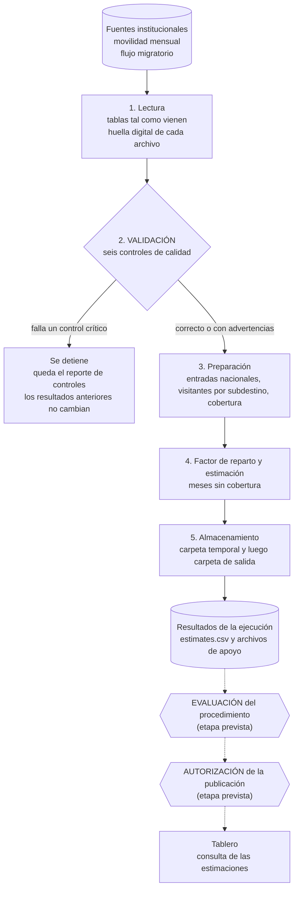

# Flujo de los datos

El flujo va desde la lectura de las fuentes institucionales hasta la consulta de las estimaciones. Se ejecuta con un solo comando (`python run_pipeline.py`) y no depende de archivos intermedios hechos a mano ni de la memoria de una sesión. El tablero no ejecuta el pipeline: solo leerá resultados ya generados, de modo que cambiar un filtro nunca vuelve a calcular nada.

Las líneas continuas son etapas que ya se ejecutan. Las líneas punteadas son etapas previstas que todavía no están implementadas: evaluar el procedimiento con meses ocultos y autorizar qué resultados puede consultar el tablero.

## Etapas

| Etapa | Qué hace | Módulo |
|---|---|---|
| 1. Lectura | Lee las seis hojas de movilidad mensual y la hoja de datos del flujo migratorio sin limpiar nada, y calcula la huella digital (SHA-256) de cada archivo. | `tourism_pipeline.ingestion` |
| 2. Validación | Ejecuta los seis controles de calidad y escribe su reporte. | `tourism_pipeline.validation` |
| 3. Preparación | Construye las entradas nacionales por mes, los visitantes por subdestino y mes, y la tabla de cobertura. | `tourism_pipeline.preparation` |
| 4. Estimación | Calcula el factor de reparto de cada subdestino con los meses de ajuste anteriores y estima los meses sin cobertura. | `tourism_pipeline.preparation`, `tourism_pipeline.estimation` |
| 5. Almacenamiento | Escribe los resultados en una carpeta temporal y, si todo terminó bien, los mueve a la carpeta de salida. | `tourism_pipeline.pipeline` |

## Dónde se valida y dónde se detiene

La validación ocurre en la etapa 2, antes de preparar los datos. Cada control tiene dos condiciones, una de advertencia (el flujo continúa y queda anotada en el reporte) y otra de parada (el flujo se detiene).

| Control | Qué verifica | Advertencia cuando | Se detiene cuando |
|---|---|---|---|
| `columns_and_types` | Columnas indispensables y tipos compatibles. | Hay columnas adicionales no esperadas. | Falta una columna indispensable o un tipo es incompatible. |
| `dates_and_coverage` | Fechas válidas y cobertura de los meses necesarios. | Los meses sin cobertura de movilidad configurados están ausentes y se dejan sin dato. | Una fecha es inválida o falta un mes necesario para el ajuste o la estimación. |
| `uniqueness` | Filas únicas según la granularidad de cada fuente. | Los duplicados están solo antes del primer año de migración que se usa. | Hay duplicados en la movilidad o en los años de migración que se usan. |
| `missing_values` | Valores faltantes que impiden estimar frente a los solo descriptivos. | Faltan valores descriptivos, dentro del umbral. | Falta un valor indispensable o los descriptivos superan el umbral. |
| `values_and_denominators` | Conteos finitos y no negativos y denominadores nacionales positivos. | Hay conteos en cero, pero ningún denominador de ajuste es cero. | Un conteo es negativo o no finito, o un denominador de ajuste no es positivo. |
| `methodology` | La serie mensual viene de la base mensual, no se suman subdestinos ni se rellenan con cero los meses sin cobertura. | La movilidad tiene meses fuera de la cobertura configurada. | Se usa la base diaria, se suman subdestinos, se arman totales o se rellenan con cero los meses sin cobertura. |

Cuando se detiene, el pipeline termina con código de salida 2, deja el reporte de controles en `output/reports/` y no toca los resultados anteriores. Los resultados nuevos se escriben primero en una carpeta temporal dentro de la carpeta de salida y solo reemplazan a los anteriores cuando todas las etapas terminaron bien.

## Archivos de salida

| Archivo | Contenido |
|---|---|
| `estimates.csv` | Estimaciones por subdestino y mes, con la ejecución que las generó. |
| `reparto_factors.csv` | Factor de reparto de cada subdestino y meses de ajuste usados. |
| `national_entries.csv` | Entradas nacionales de los meses de ajuste y de los meses estimados. |
| `coverage.csv` | Qué fuente tiene datos en cada mes de la ventana de trabajo. |
| `reports/quality_<ejecución>.json` | Resultado de los seis controles de cada ejecución, también cuando se detiene. |
